<picture>
  <source media="(prefers-color-scheme: dark)" srcset="assets/banner-dark.svg">
  <source media="(prefers-color-scheme: light)" srcset="assets/banner-light.svg">
  
</picture>

  
  
  
  
  

I'm Rendra, a software engineer building for mobile since 2019. Below is what I build in the open;
what I learn along the way goes on [lscythe.dev](https://lscythe.dev).

`STATUS` · **Open to work.** Looking for my next mobile role; reach me on
[LinkedIn](https://www.linkedin.com/in/lscythe) or by [email](mailto:rendrati15c@gmail.com).

### `NOW` · Building

<table>
  <tr>
    <td width="108"></td>
    <td>
      <a href="https://github.com/lscythe/jalvio-service"><b>Jalvio // mobility</b></a> &nbsp;<code>Go · GTFS</code> 
      An Indonesia-first mobility app. First up is its self-hosted Go backend for public transit
      data: GTFS stop and route search, live bus positions over MQTT, and stop facilities.
    </td>
  </tr>
</table>

### `BLD.01` · Open builds

<table>
  <tr>
    <td width="108"></td>
    <td>
      <a href="https://github.com/lscythe/xuefu"><b>血符 XueFu</b></a> &nbsp;<code>TypeScript · Bun</code> 
      A terminal-native developer cockpit: Jira, git, pull requests, CI, Android tooling and
      timesheets around a single work context.
    </td>
  </tr>
  <tr>
    <td width="108"></td>
    <td>
      <a href="https://github.com/lscythe/gradlens"><b>gradlens</b></a> &nbsp;<code>Rust</code> 
      Reviews Android version-catalog dependencies: transitive trees, release notes for the
      versions Gradle picks, and catalog changes against a baseline branch.
    </td>
  </tr>
  <tr>
    <td width="108"></td>
    <td>
      <a href="https://github.com/lscythe/domain-probe"><b>domain-probe</b></a> &nbsp;<code>Go</code> 
      Checks domain availability over RDAP with a WHOIS fallback, with pricing and expiring or
      dropping domains, in an interactive terminal browser.
    </td>
  </tr>
</table>

### `OPS.02` · Shipped at work

Android and Flutter apps for banks, insurers and telcos, most of them closed source:
[Now by BCA Life](https://play.google.com/store/apps/details?id=com.bcalife.now) (Kotlin, Compose),
[Livin' by Mandiri](https://play.google.com/store/apps/details?id=id.bmri.livin) (Kotlin, NFC Tap to Pay)
and Qosmo, Telkom Indonesia's network monitoring app (Flutter).
The full record is at [lscythe.dev/experience](https://lscythe.dev/experience).

### `LOG.03` · Latest entries

<!-- BLOG-POST-LIST:START -->
- `2026.03.09` · [The Cure](https://lscythe.dev/blog/migrating-legacy-code/the-cure)
- `2026.03.07` · [Process Death – The Invisible Crash](https://lscythe.dev/blog/rebooting-android-basics/process-death)
- `2026.03.06` · [Threading 101 – Mastering Dispatchers and Coroutines](https://lscythe.dev/blog/rebooting-android-basics/threading-101)
- `2026.03.05` · [The Chaos](https://lscythe.dev/blog/migrating-legacy-code/the-chaos)
- `2026.03.05` · [Memory Leak Hunting – The Modern Culprits](https://lscythe.dev/blog/rebooting-android-basics/memory-leak-hunting)

<!-- BLOG-POST-LIST:END -->

Full archive at <a href="https://lscythe.dev/blog">lscythe.dev/blog</a> · <a href="https://lscythe.dev/rss.xml">RSS</a>

<picture>
  <source media="(prefers-color-scheme: dark)" srcset="assets/stats-dark.svg">
  <source media="(prefers-color-scheme: light)" srcset="assets/stats-light.svg">
  
</picture>

`炼器 liàn qì` &nbsp;·&nbsp; Android since 2019 &nbsp;·&nbsp; Shipping from Jakarta
