<a href="https://lscythe.dev">
  <picture>
    <source media="(prefers-color-scheme: dark)" srcset="assets/banner-dark.svg">
    <source media="(prefers-color-scheme: light)" srcset="assets/banner-light.svg">
    
  </picture>
</a>

  
  
  
  
  

### `USR.00` · Dossier

I'm Rendra, a **software engineer** who builds things for mobile. I build apps for banks, insurers
and telcos, mostly in Kotlin, and write down what I learn on [lscythe.dev](https://lscythe.dev):
no ads, no AI-written posts, no paywall.

| | |
| :-- | :-- |
| `CLASS` | Software engineer |
| `FOCUS` | Mobile · Android |
| `LANGS` | Kotlin · Java · Dart |
| `LEARNING` | Golang |
| `FIRST CODE` | 2013 · HTML in Notepad |
| `BASE` | Jakarta · -6.21 / 106.85 |

### `NOW` · Building

**Navigo // transit**: a transit app. Backend first, then the mobile app.

- [ ] Backend ← in progress
- [ ] Mobile

### `BLD.03` · Field deployments

| | Project | Built at | Stack |
| :-: | :-- | :-- | :-- |
| 🟢 | [Now by BCA Life](https://play.google.com/store/apps/details?id=com.bcalife.now) | SALT | Kotlin · Jetpack Compose · Ktor · Koin · Room |
| 🟢 | [Livin' by Mandiri](https://play.google.com/store/apps/details?id=id.bmri.livin) | Bumi Amartha Teknologi Mandiri | Kotlin · Hilt · Room · Coroutines · NFC |
| 🟣 | Qosmo | SALT, for Telkom Indonesia | Flutter · Melos · Cubit · Dio |
| 🟢 | [lscythe.dev](https://github.com/lscythe/website) | Side project | SvelteKit · TypeScript · Cloudflare Workers |

🟢 live &nbsp;·&nbsp; 🟣 internal &nbsp;·&nbsp; full index at <a href="https://lscythe.dev/projects">lscythe.dev/projects</a>

### `SEQ.02` · Series runs

- **[Rebooting Android Basics](https://lscythe.dev/blog/rebooting-android-basics/why-relearn-fundamentals)**
  `15 parts`: going back to the roots, and why the fundamentals still matter after years of
  building apps.
- **[Migrating Legacy Code](https://lscythe.dev/blog/migrating-legacy-code/the-context)**
  `4 parts`: the context, the catalyst, the chaos and the cure.

### `STK.04` · Stack

  
  
  
  
  
  

`炼器 liàn qì` &nbsp;·&nbsp; Android since 2019 &nbsp;·&nbsp; Shipping from Jakarta
